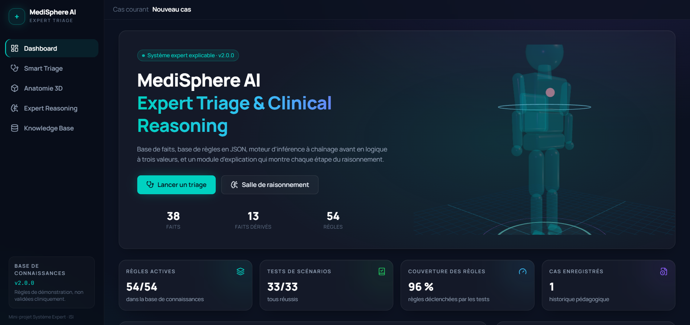
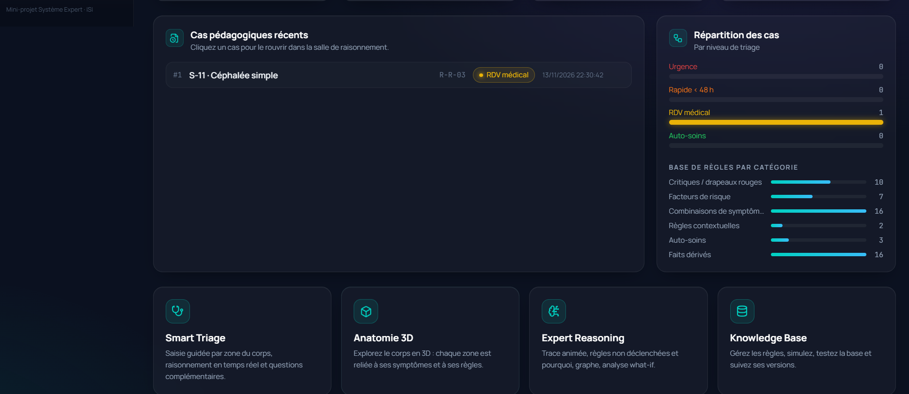
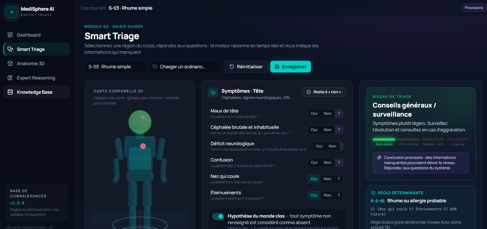
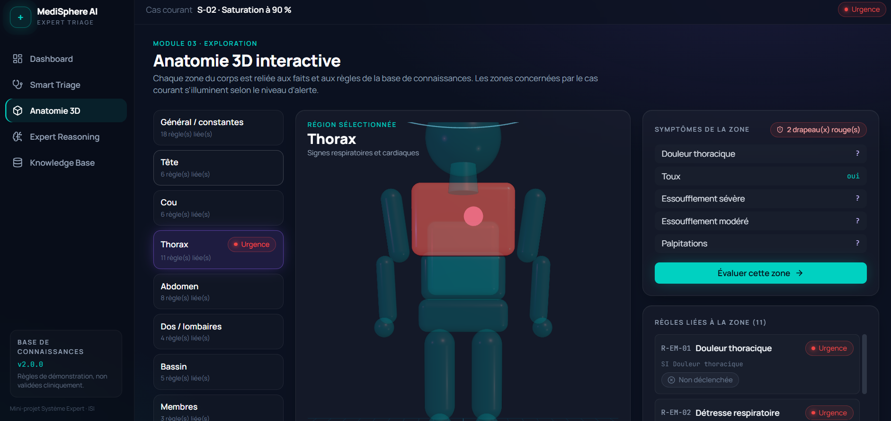
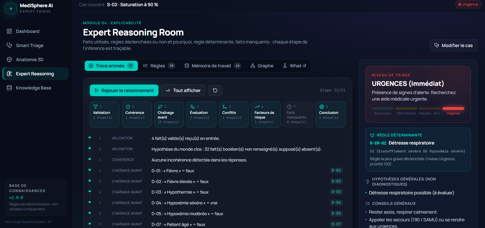
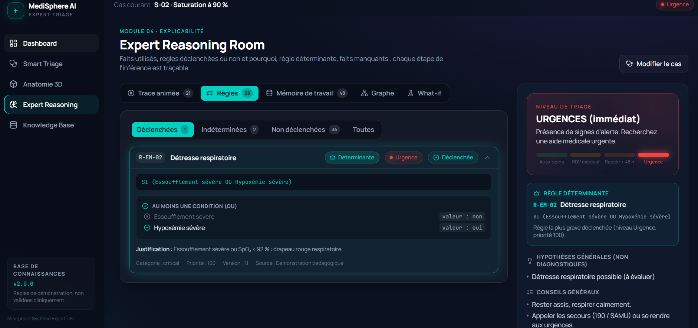
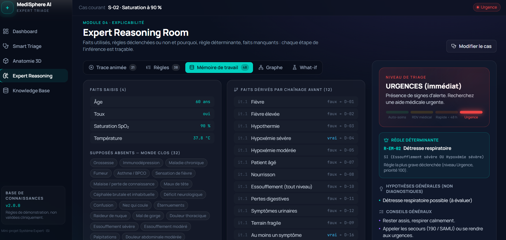
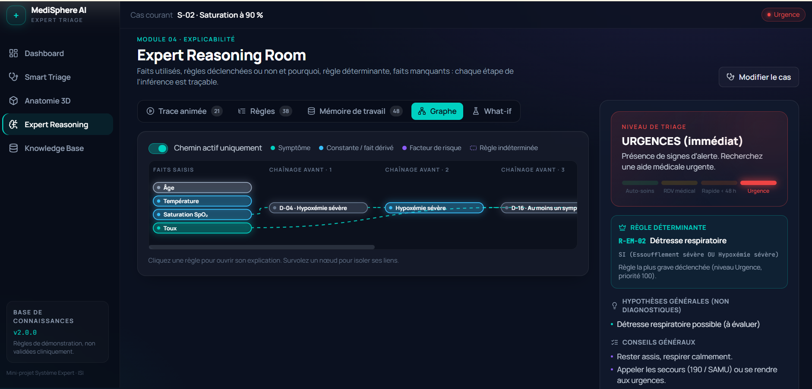
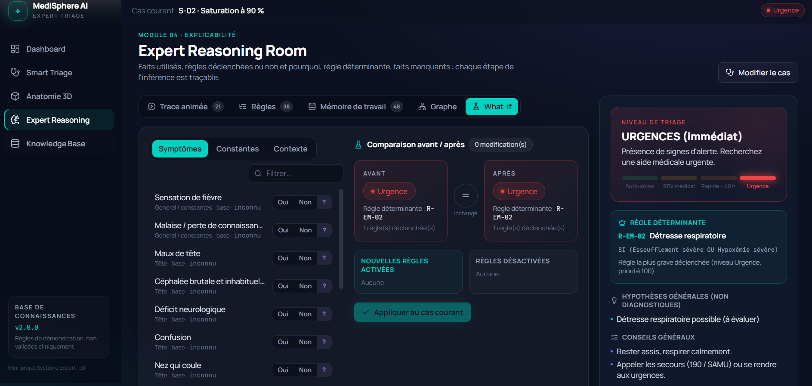
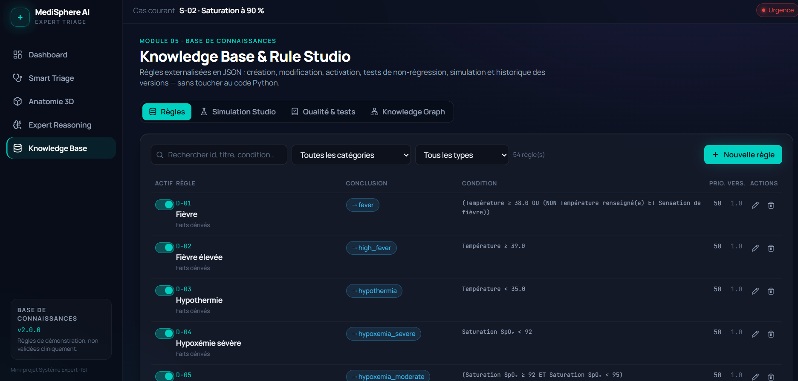

<div align="center">

# 🩺 MediSphere AI
### Expert Triage & Clinical Reasoning

**Système expert de triage médical pédagogique** : base de faits, base de règles JSON, moteur d'inférence explicable et interface 3D interactive.


<sub>Démo accélérée (34 s) · <a href="docs/demo.mp4">version MP4</a></sub>

</div>

> ⚠️ **Outil éducatif, pas un outil de diagnostic.** Les règles sont des connaissances de démonstration, non validées cliniquement.

---

## Sommaire

1. [Aperçu de l'application](#-aperçu-de-lapplication)
2. [Comment raisonne le moteur](#-comment-raisonne-le-moteur)
3. [Installation et lancement](#-installation-et-lancement)
4. [Structure du projet](#-structure-du-projet)

---

## 📸 Aperçu de l'application

### 1. Dashboard

Vue d'ensemble du système : corps 3D holographique, taille de la base (38 faits, 13 faits dérivés, 54 règles), résultats des tests et couverture des règles.



L'historique des cas pédagogiques enregistrés s'affiche en bas de la page, avec leur répartition par niveau de triage et la composition de la base de règles par catégorie.



### 2. Smart Triage

On clique une zone du corps 3D et on répond **Oui / Non / ?** aux questions. Le moteur raisonne **en temps réel** et affiche le niveau, la règle déterminante, les hypothèses et les conseils.

**Cas bénin** (scénario S-03, rhume) : la règle `R-S-01` conclut « auto-soins ». Le résultat reste **provisoire**, car certaines constantes ne sont pas renseignées.



**Cas grave** (scénario S-02, SpO₂ à 90 %) : la règle `R-EM-02` conclut « Urgences » et le thorax s'illumine en rouge sur le corps 3D.


### 3. Anatomie 3D

Chaque zone du corps est reliée à ses symptômes et à ses règles. Les zones concernées par le cas courant pulsent selon leur niveau d'alerte, et le compteur indique le nombre de drapeaux rouges de la zone.



### 4. Expert Reasoning Room

Le cœur explicable du système, organisé en 5 onglets.

**Trace animée** : le raisonnement est rejoué étape par étape, à travers 8 phases (validation, cohérence, chaînage avant, évaluation, conflits, facteurs de risque, faits manquants, conclusion).



**Règles** : chaque règle est déclenchée, indéterminée ou non déclenchée. Son arbre d'évaluation montre la valeur de chaque condition (✓ vrai, ✗ faux, ? inconnu).



**Mémoire de travail** : on y voit les faits saisis, les faits supposés absents (hypothèse du monde clos) et les faits **dérivés par chaînage avant**, chacun avec son itération et la règle qui l'a produit.



**Graphe** : le chemin du raisonnement s'illumine, des faits saisis jusqu'au niveau final, en passant par les règles et les faits dérivés.



**What-if** : on modifie un fait et le système compare les deux raisonnements (niveau avant/après, règles activées ou désactivées).



### 5. Knowledge Base & Rule Studio

Les 54 règles sont stockées en JSON et gérées sans toucher au code. On peut les rechercher, les filtrer, les activer ou désactiver, les créer et les modifier avec une validation en direct. Chaque modification crée une **version restaurable**. Les autres onglets regroupent le Simulation Studio, les tests de non-régression et le Knowledge Graph.



---

## 🧠 Comment raisonne le moteur

```
Faits saisis ─▶ Validation ─▶ Cohérence ─▶ Chaînage avant ─▶ Évaluation des règles
                                         (faits dérivés)    (vrai / faux / inconnu)
                                                                     │
Conclusion + règle déterminante + questions utiles ◀─ Facteurs de risque ◀─ Conflits
```

| Concept | En bref |
|---|---|
| **Chaînage avant** | Les règles de dérivation s'appliquent jusqu'à ce que plus aucun fait nouveau n'apparaisse (point fixe). Exemple : `âge ≥ 65` → `patient âgé` → `terrain fragile`. |
| **Logique à 3 valeurs** | Une information non renseignée reste *inconnue*. Une règle peut donc être **indéterminée**, et le résultat est alors marqué **provisoire**. |
| **Questions utiles** | Le système classe les informations manquantes selon leur capacité à aggraver le niveau, et les pose en priorité. |
| **Facteurs de risque** | Immunodépression, grossesse, âge, asthme, etc. imposent un **niveau minimum** ou font **monter le niveau d'un cran**. |
| **Conflits** | Si une règle d'auto-soins et une règle d'urgence se déclenchent ensemble, le niveau le plus grave l'emporte (principe de précaution). |
| **Pas de fausse réassurance** | Sans symptôme, la réponse est « Données insuffisantes », jamais « auto-soins » par défaut. |

Exemple de règle dans `backend/knowledge/rules.json` :

```json
{
  "id": "R-EM-04", "title": "Raideur de nuque + fièvre",
  "kind": "triage", "category": "critical", "level": "EMERGENCY", "priority": 95,
  "condition": {"all": [{"fact": "stiff_neck"}, {"fact": "fever"}]},
  "advice": ["Se rendre aux urgences sans attendre."]
}
```

---

## 🚀 Installation et lancement

Prérequis : **Python ≥ 3.10** et **Node.js ≥ 18**.

**Terminal 1 : API**

```bash
cd backend
pip install -r requirements.txt
python -m uvicorn app.main:app --reload --port 8000
```

**Terminal 2 : interface**

```bash
cd frontend
npm install
npm run dev
```

Ouvrir **http://localhost:5173**. La documentation de l'API est disponible sur http://localhost:8000/docs.

**Tests du moteur :**

```bash
cd backend
python -m unittest discover -s tests -v
```

---

## 📁 Structure du projet

```
medisphere/
├── backend/
│   ├── app/
│   │   ├── engine/          # conditions, base de connaissances, moteur d'inférence, analyse
│   │   ├── service.py       # logique métier (testable sans FastAPI)
│   │   ├── storage.py       # historique des cas (SQLite)
│   │   └── main.py          # API FastAPI
│   ├── knowledge/           # facts.json · rules.json · scenarios.json · history/
│   └── tests/
├── frontend/src/
│   ├── pages/               # Dashboard, SmartTriage, Anatomy, Reasoning, KnowledgeBase
│   └── components/          # Body3D (Three.js), ReasoningGraph, TracePlayer, Simulator…
└── docs/                    # captures d'écran et démo
```

---

<div align="center">
<sub>Mini-projet Système Expert · ISI Tunis · Khadija Bensaad</sub>
</div>
